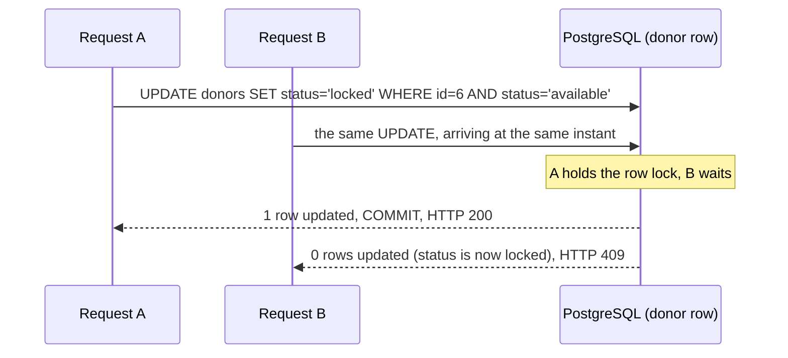
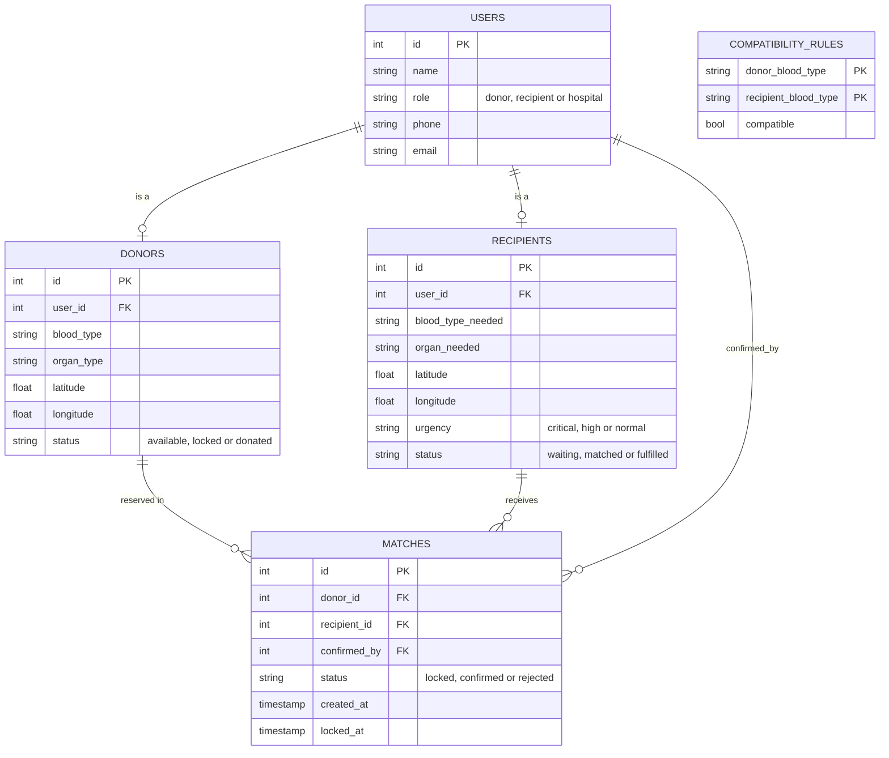

<h1 align="center">Blood/Organ Donor–Recipient Matching Registry</h1>

<p align="center">
  A database-backed web app that matches donors to waiting recipients by <b>blood-group compatibility</b> and <b>distance</b>,<br>
  and guarantees a donor can <b>never be double-booked</b>, even when requests arrive at the same instant.
</p>

<p align="center">
  
  
  
  
  
</p>

<p align="center">
  
</p>

## Why this project

Coordinating blood and organ donors by phone calls and group chats is slow, error-prone, and unsafe under pressure: the same donor can easily be promised to two patients. This project treats it as what it really is, a **data-management and concurrency problem**, and solves it with relational design instead of application-side guesswork.

## What it does

- **Registers** donors, recipients (blood type, organ, location, urgency) and hospital staff
- **Finds compatible donors in one SQL query**: recipients ⋈ a 27-row compatibility table ⋈ donors, ranked by great-circle distance
- **Reserves a donor safely**: only one recipient can ever hold a given donor, verified by a concurrent stress test
- **Hospital workflow**: confirm a locked match (donor becomes `donated`) or release it (donor returns to the pool)
- **Live dashboard** with four views: Find matches, Register, Hospital desk, Registry

## Screenshots

| Donor locked for a recipient | Hospital desk: confirm or release |
|---|---|
|  |  |

| Match confirmed | Registry |
|---|---|
|  |  |

## Engineering highlights

### 1. Compatibility is data, not code

Blood-group rules never change, so all 27 valid donor → recipient pairs live in a lookup table. "Who can donate to whom?" becomes an ordinary join: no nested `if/else`, and no graph database for an 8-node, 27-edge graph.

```sql
SELECT d.id AS donor_id, d.blood_type,
       ROUND((6371 * acos(LEAST(1.0, GREATEST(-1.0,       -- clamp: float error can push acos out of range
           cos(radians(r.latitude)) * cos(radians(d.latitude)) *
           cos(radians(d.longitude) - radians(r.longitude)) +
           sin(radians(r.latitude)) * sin(radians(d.latitude)))))
       )::numeric, 1) AS distance_km
FROM recipients r
JOIN compatibility_rules cr ON cr.recipient_blood_type = r.blood_type_needed
JOIN donors d               ON d.blood_type = cr.donor_blood_type
                           AND d.organ_type = r.organ_needed
WHERE d.status = 'available' AND r.status = 'waiting' AND r.id = :recipient_id
ORDER BY distance_km
LIMIT 10;
```

`EXPLAIN ANALYZE` confirms index-only access: a primary-key lookup on the recipient, a **partial index** on available donors, and an index-only scan of the rules table.

### 2. Double-booking is prevented in three layers



| Layer | Mechanism | What it guarantees |
|---|---|---|
| 1 | Atomic conditional `UPDATE ... WHERE status='available'` | Exactly one of many simultaneous requests wins the donor |
| 2 | `SELECT ... FOR UPDATE` on the recipient, always **recipient first, donor second** | A recipient cannot hold two donors, and deadlock is impossible (fixed lock order) |
| 3 | **Partial unique indexes** on live matches (`WHERE status IN ('locked','confirmed')`) | Even if the app code had a bug, PostgreSQL itself refuses a second live match |

Everything runs in **one transaction**, so a crash halfway rolls back cleanly and no half-finished state is ever stored. The lock endpoint also **re-validates** blood and organ compatibility on the server instead of trusting the client.

### 3. Verified, not assumed

`test_concurrency.py` releases **8 threads at the same instant**, all trying to lock the same donor:

```
recipient 4:  HTTP 409  {'detail': 'Donor already claimed by someone else'}
recipient 5:  HTTP 409  ...
recipient 7:  HTTP 200  {'match_id': 3, 'status': 'locked'}
... (5 more 409s)
Successful locks: 1  (expected 1)
PASS: exactly one recipient locked the donor.
```

Plus 16 more API tests (validation errors, authorisation, incompatible locks, state-machine rules, release flow): **17 of 17 passing**.

## Database design



- Normalised to **3NF**: identity stored once in `users`; role-specific facts in `donors` / `recipients`
- **CHECK constraints** reject invalid blood types, urgency, status and out-of-range coordinates at the database level, in addition to Pydantic validation in the API
- Controlled redundancy: `status` columns on donors and recipients enable cheap indexed filtering and the atomic claim; transactions keep them consistent with `matches`

## Tech stack

**PostgreSQL** · **Python 3.12** · **FastAPI** · **psycopg2** (connection pool) · **Pydantic** · vanilla **HTML/CSS/JavaScript** (single file, no build step)

## Quick start

```bash
# 1. Create the database and load schema + demo data
createdb donor_registry
psql -d donor_registry -f schema.sql
psql -d donor_registry -f seed.sql

# 2. Install and run
pip install -r requirements.txt
export DATABASE_URL="dbname=donor_registry user=postgres password=YOURPASSWORD host=localhost port=5432"
uvicorn main:app --reload
```

Windows (Command Prompt): use `set DATABASE_URL=...` instead of `export`. PowerShell: `$env:DATABASE_URL="..."`.

Then open **http://127.0.0.1:8000** for the app and **http://127.0.0.1:8000/docs** for interactive API docs. With the server running, try the race test: `python test_concurrency.py`. To reset the demo data, re-run `schema.sql` then `seed.sql`.

## API

| Method | Endpoint | Purpose |
|---|---|---|
| `POST` | `/api/donors` · `/api/recipients` · `/api/hospitals` | Register |
| `GET` | `/api/recipients/{id}/matches` | Compatible donors, nearest first |
| `POST` | `/api/matches/lock` | Reserve a donor (`200` locked, `400` incompatible, `409` already taken) |
| `POST` | `/api/matches/{id}/confirm` | Hospital confirms (`403` if not hospital staff) |
| `POST` | `/api/matches/{id}/reject` | Hospital releases the lock |
| `GET` | `/api/donors` · `/api/recipients` · `/api/matches` · `/api/stats` | Dashboard data |

## Project structure

```
├── schema.sql            5 tables, constraints, compatibility rules, indexes
├── seed.sql              demo data: 2 hospitals, 5 donors, 3 recipients
├── main.py               FastAPI backend: register, match, lock, confirm, release
├── index.html            four-tab web interface
├── test_concurrency.py   8-way simultaneous-lock stress test
├── requirements.txt
└── screenshots/
```

## Limitations and roadmap

This is an academic prototype, **not a clinical tool**. Organ matching uses ABO compatibility plus organ type; real transplantation also needs HLA typing, size matching and medical judgement.

- [ ] Authentication with JWT and role-based permissions for hospital staff
- [ ] Lock expiry: auto-release stale locks after a time limit
- [ ] PostGIS with a spatial index for large-scale proximity search
- [ ] Road distance and travel time instead of straight-line distance
- [ ] SMS / e-mail notifications
- [ ] React + TypeScript front end

## Author

**Akshita Dahiya** · Computer Science and Engineering, VIT Vellore
Built as a Database Systems (BCSE302L) case study. Feedback and suggestions are welcome via Issues.
